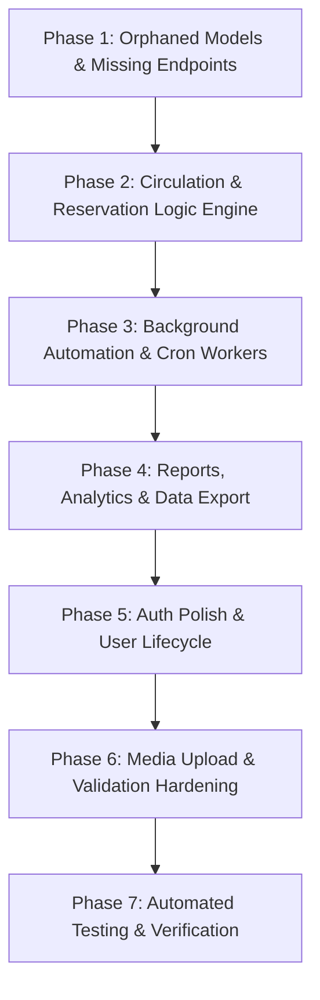

# Comprehensive Backend Implementation Plan

> **Project:** Library Management System — Monorepo Backend  
> **Target Directory:** `backend/`  
> **Status:** Planning & Execution Roadmap  
> **Scope:** Backend Complete Implementation (Frontend integration is excluded and will be handled in a subsequent phase).

---

## 1. Executive Summary & Objectives

The backend currently provides a solid architectural foundation (Express, Mongoose, JWT auth, and baseline CRUD for books, users, transactions, and acquisitions), representing approximately 60–65% completion.

### Primary Objectives of This Plan
1. **Activate Orphaned Schemas:** Implement controllers, routes, and validation for `FeeStructure`, `Budget`, and `VendorQuote`.
2. **Close Business Logic Loops:**
   - Link circulation rules (loan duration, renewals, borrowing limits) directly to the dynamic `Settings` collection.
   - Automatically calculate late fees and create `Fine` records upon late returns using `FeeStructure`.
   - Wire book returns into the `Reservation` queue so waiting patrons automatically receive held books.
3. **Automate Operational Routines:** Add scheduled background jobs (`node-cron`) for overdue transaction checks, daily fine accruals, hold expirations, and notification dispatches.
4. **Expand Reporting & Analytics:** Deliver comprehensive circulation analytics, inventory tracking, financial summaries, and CSV export capabilities.
5. **Auth & Identity Polish:** Automate `membershipId` generation for self-registered users, add admin approval notifications, and implement tokenized password reset.
6. **File & Media Handling (ImageKit.io):** Support book cover image uploads to ImageKit.io cloud storage via `multer` memory storage and the official `imagekit` SDK, delivering CDN-delivered optimized URLs and asset management.
7. **Production Hardening & Testing:** Implement rate limiting, route validation parity, and automated integration tests (`jest`/`vitest` + `supertest`).

---

## 2. Phase-by-Phase Roadmap



---

## Phase 1: Orphaned Models & Missing Endpoints

The database schemas for `Budget`, `FeeStructure`, and `VendorQuote` exist in `src/models/` but lack controllers and routes. This phase turns these models into fully functional REST resources.

### 1.1 Fee Structure Management
- **Files to Create:**
  - `backend/src/controllers/feeStructure.controller.js`
  - `backend/src/routes/feeStructure.routes.js`
- **Endpoints to Implement:**
  | Method | Path | Auth / Role | Description |
  | :--- | :--- | :--- | :--- |
  | `GET` | `/api/fee-structures` | Protected (`admin`, `librarian`) | List all active/inactive fee structures |
  | `GET` | `/api/fee-structures/:id` | Protected (`admin`, `librarian`) | Get single fee structure details |
  | `POST` | `/api/fee-structures` | Protected (`admin`) | Create fee structure (`overdue`, `lost`, `damaged`, `processing`) |
  | `PUT` | `/api/fee-structures/:id` | Protected (`admin`) | Update rates, limits, or applicability |
  | `DELETE`| `/api/fee-structures/:id` | Protected (`admin`) | Soft deactivate or delete fee structure |
- **Validation Rules:**
  - `type`: Must be one of `['overdue', 'lost', 'damaged', 'processing']`
  - `rate`: Float $\ge 0$
  - `rateType`: Must be one of `['per_day', 'fixed', 'percentage']`
  - `maxAmount`: Optional float $\ge 0$

### 1.2 Library Budgets & Financial Allocations
- **Files to Create:**
  - `backend/src/controllers/budget.controller.js`
  - `backend/src/routes/budget.routes.js`
- **Endpoints to Implement:**
  | Method | Path | Auth / Role | Description |
  | :--- | :--- | :--- | :--- |
  | `GET` | `/api/budgets` | Protected (`admin`, `librarian`) | List budgets (filter by `isActive`, date range) |
  | `GET` | `/api/budgets/:id` | Protected (`admin`, `librarian`) | Single budget details with calculated virtuals |
  | `POST` | `/api/budgets` | Protected (`admin`) | Allocate new department / fiscal budget |
  | `PUT` | `/api/budgets/:id` | Protected (`admin`) | Update allocated amount, dates, or notes |
  | `DELETE`| `/api/budgets/:id` | Protected (`admin`) | Deactivate budget |
- **Business Logic:**
  - Ensure `spentAmount` cannot exceed `totalAmount` unless explicit deficit override is provided.
  - Return virtual fields: `remainingAmount` and `utilizationPercent`.

### 1.3 Vendor Quotes & Bidding
- **Files to Create:**
  - `backend/src/controllers/vendorQuote.controller.js`
  - `backend/src/routes/vendorQuote.routes.js`
- **Endpoints to Implement:**
  | Method | Path | Auth / Role | Description |
  | :--- | :--- | :--- | :--- |
  | `GET` | `/api/vendor-quotes` | Protected (`admin`, `librarian`) | List quotes (filter by `acquisitionId`, `vendorId`, `status`) |
  | `GET` | `/api/vendor-quotes/:id` | Protected (`admin`, `librarian`) | Get single quote with populated acquisition & vendor |
  | `POST` | `/api/vendor-quotes` | Protected (`admin`, `librarian`) | Submit a quote received from a vendor |
  | `PUT` | `/api/vendor-quotes/:id/status` | Protected (`admin`) | Accept or reject a quote (`status: "accepted" \| "rejected"`) |
  | `DELETE`| `/api/vendor-quotes/:id` | Protected (`admin`) | Delete pending quote |
- **Business Logic:**
  - When a quote is accepted, update associated `Acquisition` record's `vendorId` and `unitPrice`, and mark competing quotes for that acquisition as `rejected`.

### 1.4 Route Registration
- Update `backend/src/app.js` to mount:
  - `app.use("/api/fee-structures", feeStructureRoutes);`
  - `app.use("/api/budgets", budgetRoutes);`
  - `app.use("/api/vendor-quotes", vendorQuoteRoutes);`

---

## Phase 2: Circulation, Reservations & Settings Integration

Currently, loan periods are hardcoded (14 days), returns don't assess fines, and returned books don't notify reservations. This phase wires all circulation logic into a cohesive engine.

### 2.1 Dynamic Settings Integration
- **Files to Modify:**
  - `backend/src/controllers/transaction.controller.js`
  - `backend/src/utils/settingsHelper.js` *(new helper)*
- **Helper Implementation (`settingsHelper.js`):**
  - Implement an in-memory cached lookup for settings from the DB with a 5-minute TTL to prevent constant DB reads on hot endpoints:
    ```javascript
    getSetting(key, defaultValue)
    ```
- **Updates to `borrowBook`:**
  - Instead of fixed 14 days, dynamically determine due date based on borrower's role:
    - Patron $\rightarrow$ query `loan_period_patron` (default 14)
    - Librarian $\rightarrow$ query `loan_period_librarian` (default 21)
    - Admin $\rightarrow$ query `loan_period_admin` (default 30)
  - Enforce user borrowing limit dynamically: check against user's specific `borrowingLimit` or default `max_books_patron`.
  - Block borrowing if user's outstanding `finesOwed` exceeds `fine_block_threshold` (from settings).

### 2.2 Automated Return & Overdue Fine Generation
- **Files to Modify:**
  - `backend/src/controllers/transaction.controller.js`
- **Implementation in `returnBook`:**
  - Check if `new Date() > transaction.dueDate`.
  - If overdue:
    - Calculate days overdue: `Math.ceil((now - dueDate) / (1000 * 60 * 60 * 24))`.
    - Fetch active `overdue` fee structure from `FeeStructure` or fallback to `Settings.fine_rate_per_day`.
    - Calculate fine: `daysOverdue * rate` (capped at `maxAmount` if specified).
    - Create `Fine` record linked to `userId` and `transactionId`.
    - Atomically increment `user.finesOwed += fineAmount`.
    - Update `transaction.fine = fineAmount` and `transaction.status = "returned"`.
    - Create an alert notification for the user with details of the assessed fine.

### 2.3 Reservation Fulfillment on Return
- **Files to Modify:**
  - `backend/src/controllers/transaction.controller.js`
  - `backend/src/controllers/reservation.controller.js`
- **Implementation in `returnBook`:**
  - Before marking book as `available`, check for pending reservations on this `bookId`:
    ```javascript
    const nextInQueue = await Reservation.findOne({
      bookId,
      status: "pending"
    }).sort({ queuePosition: 1 });
    ```
  - If a reservation exists:
    - Set `book.status = "reserved"`. (Keep `availableCopies` at 0 until patron picks it up or hold expires).
    - Update reservation status to `ready`.
    - Set `reservation.expiryDate = now + holdDays` (reading `reservation_hold_days` from Settings, default 3 days).
    - Send notification to the patron: *"Your reserved book is now ready for pickup. Hold expires on [Date]"*.
  - If no reservations exist:
    - Increment `book.availableCopies += 1` and set `book.status = "available"`.

### 2.4 Queue Re-Ordering on Reservation Cancellation
- **Files to Modify:**
  - `backend/src/controllers/reservation.controller.js`
- **Implementation in `cancelReservation`:**
  - When reservation with `queuePosition = N` is cancelled, decrement `queuePosition` by 1 for all active reservations on the same `bookId` where `queuePosition > N`.

---

## Phase 3: Background Automation & Scheduled Tasks (Cron Jobs)

To ensure the library system remains consistent without requiring manual staff intervention for overdue checks and hold expirations, introduce background workers using `node-cron`.

### 3.1 Cron Infrastructure Setup
- **Dependencies:** Install `node-cron`
  ```bash
  npm install node-cron
  ```
- **Files to Create:**
  - `backend/src/jobs/index.js`
  - `backend/src/jobs/overdueCheck.job.js`
  - `backend/src/jobs/reservationExpiry.job.js`
  - `backend/src/jobs/membershipExpiry.job.js`
- **Integration:** Initialize jobs in `backend/server.js` after database connection is verified.

### 3.2 Scheduled Workers Specification
1. **Daily Overdue Check (`overdueCheck.job.js`)**
   - **Schedule:** Run daily at midnight (`0 0 * * *`).
   - **Actions:**
     - Query all transactions where `status === "active"` and `dueDate < new Date()`.
     - Update transaction status to `overdue`.
     - For transactions already overdue, calculate and accumulate daily late fines if incremental fines are enabled.
     - Dispatch "Overdue Notice" notifications to affected users.
2. **Reservation Expiry Worker (`reservationExpiry.job.js`)**
   - **Schedule:** Run hourly (`0 * * * *`).
   - **Actions:**
     - Find reservations where `status === "ready"` and `expiryDate < new Date()`.
     - Mark status as `expired`.
     - Notify the user that their hold expired.
     - Check if there is a next patron in line (`queuePosition = 2`); if yes, promote them to `ready`, set new `expiryDate`, and notify them.
     - If no more reservations exist, release the book (`book.status = "available"`, `book.availableCopies += 1`).
3. **Due Date Reminder Worker**
   - **Schedule:** Run daily at 08:00 AM (`0 8 * * *`).
   - **Actions:**
     - Find active transactions due in 48 hours.
     - Dispatch "Upcoming Due Date Reminder" notifications.

---

## Phase 4: Reports, Analytics & Data Export

Transform `report.controller.js` from a 4-line summary into a comprehensive reporting module.

### 4.1 Reporting Endpoints
- **Files to Modify:**
  - `backend/src/controllers/report.controller.js`
  - `backend/src/routes/report.routes.js`
- **Endpoints to Implement:**
  | Method | Path | Auth / Role | Description |
  | :--- | :--- | :--- | :--- |
  | `GET` | `/api/reports/dashboard-stats` | Protected (`admin`, `librarian`) | High-level KPI cards (existing, enhanced with period comparisons) |
  | `GET` | `/api/reports/circulation-trends` | Protected (`admin`, `librarian`) | Borrow/return counts grouped by day/month over a date range |
  | `GET` | `/api/reports/popular-books` | Protected (`admin`, `librarian`) | Top borrowed books with total borrow count |
  | `GET` | `/api/reports/overdue-aging` | Protected (`admin`, `librarian`) | Overdue loans categorized by buckets (1-7 days, 8-14 days, 15-30 days, 30+ days) |
  | `GET` | `/api/reports/financial-summary` | Protected (`admin`) | Total fines issued, collected, waived, and invoice payments over time |
  | `GET` | `/api/reports/category-distribution`| Protected (`admin`, `librarian`) | Inventory and loan share per book category |
  | `GET` | `/api/reports/export/:type` | Protected (`admin`, `librarian`) | Export data as CSV (`type: "books" \| "members" \| "transactions" \| "fines"`) |

### 4.2 CSV Export Implementation
- **Dependencies:** Install `json2csv` or implement lightweight CSV serialization.
  ```bash
  npm install @json2csv/node
  ```
- Send response with proper headers:
  ```javascript
  res.header("Content-Type", "text/csv");
  res.attachment(`${type}-report-${Date.now()}.csv`);
  ```

---

## Phase 5: Authentication & User Lifecycle Polish

### 5.1 Member Self-Registration & Approval Loop
- **Files to Modify:**
  - `backend/src/controllers/auth.controller.js`
  - `backend/src/controllers/user.controller.js`
- **Improvements:**
  - Auto-generate `membershipId` upon registration using `user.generateMembershipId()`.
  - When an admin updates a user's `approvalStatus` to `"approved"`:
    - Automatically ensure `isActive: true`.
    - Set `membershipExpiry = Date.now() + 1 year` (or setting value).
    - Generate a system notification: *"Your library membership has been approved! Your member ID is PATxxxx."*

### 5.2 Password Reset Workflow
- **Files to Modify:**
  - `backend/src/models/User.js` (add `resetPasswordToken` and `resetPasswordExpire`)
  - `backend/src/routes/auth.routes.js`
  - `backend/src/controllers/auth.controller.js`
- **Endpoints to Implement:**
  | Method | Path | Auth | Description |
  | :--- | :--- | :--- | :--- |
  | `POST` | `/api/auth/forgot-password` | Public | Generates hashed reset token (valid 15 mins) and logs/sends token |
  | `POST` | `/api/auth/reset-password/:token`| Public | Validates token, hashes new password, clears token |

---

## Phase 6: Media Upload, Validation Parity & Security Hardening

### 6.1 Book Cover & Asset Uploads (ImageKit.io Cloud Storage)
- **Dependencies:** Install `imagekit` and `multer`
  ```bash
  npm install imagekit multer
  ```
- **Environment Variables Required:**
  Add to `.env` and `.env.example`:
  ```env
  IMAGEKIT_PUBLIC_KEY=your_imagekit_public_key
  IMAGEKIT_PRIVATE_KEY=your_imagekit_private_key
  IMAGEKIT_URL_ENDPOINT=https://ik.imagekit.io/your_imagekit_id
  ```
- **Files to Create:**
  - `backend/src/config/imagekit.js` (ImageKit SDK client initialization)
  - `backend/src/middleware/upload.js` (`multer` with memory storage buffer & image MIME filters)
- **Implementation:**
  - **Memory Storage:** Uploads are buffered in memory (`multer.memoryStorage()`) instead of writing to local disk.
  - **File Filter & Constraints:** Accept only `image/jpeg`, `image/png`, `image/webp`. Max file size: 5MB.
  - **ImageKit Upload Integration:**
    ```javascript
    const response = await imagekit.upload({
      file: req.file.buffer.toString("base64"),
      fileName: `book_cover_${book._id}_${Date.now()}`,
      folder: "/library-management/book-covers",
      useUniqueFileName: true,
    });
    // response.url provides CDN URL, response.fileId allows deletion
    ```
  - **Model Update:** In `Book.js`, store `coverImage` (CDN URL) and `coverImageFileId` (ImageKit file ID for clean deletion).
  - **Endpoints in `book.routes.js`:**
    - `POST /api/books/:id/cover` (Protected `admin`, `librarian`, `upload.single("cover")`, uploads to ImageKit and updates book record).
    - `DELETE /api/books/:id/cover` (Protected `admin`, `librarian`, removes file from ImageKit via `imagekit.deleteFile()` and clears `coverImage`).

### 6.2 Route Query Validation Parity
- Add missing query parameter validators (`express-validator`) across:
  - `acquisition.routes.js` (`page`, `limit`, `status`, `vendorId`)
  - `invoice.routes.js` (`paymentStatus`, `vendorId`, `page`, `limit`)
  - `vendor.routes.js` (`isActive`, `q`, `page`, `limit`)
  - `ill.routes.js` (`status`, `page`, `limit`)
  - `branch.routes.js` (`isActive`)

### 6.3 Security Hardening & Rate Limiting
- **Dependencies:** Install `express-rate-limit`
  ```bash
  npm install express-rate-limit
  ```
- **Implementation:**
  - Apply auth rate limiter: maximum 10 requests per 15 minutes on `/api/auth/login` and `/api/auth/register` to protect against brute-force attacks.
  - General API rate limiter: 300 requests per 15 minutes per IP.

---

## Phase 7: Automated Testing & Verification Suite

Currently, the backend has 0 automated tests. This phase sets up testing to guarantee all critical paths work reliably.

### 7.1 Test Framework Setup
- **Dependencies:**
  ```bash
  npm install -D vitest supertest mongodb-memory-server
  ```
- **Files to Create:**
  - `backend/vitest.config.js`
  - `backend/tests/setup.js` (starts in-memory MongoDB, connects Mongoose, handles teardown)
  - `backend/package.json` $\rightarrow$ add script `"test": "vitest run"`

### 7.2 Test Test-Suites to Implement
1. **`tests/auth.test.js`**:
   - Register, duplicate email prevention, login, invalid credentials, JWT token verification, `/me` profile fetch.
2. **`tests/books.test.js`**:
   - Create book with ISBN duplicate prevention, filter books by category/status, pagination, update book, soft delete.
3. **`tests/transactions.test.js`**:
   - Borrow available book (verifies `availableCopies` decreases and status updates).
   - Return book (verifies `availableCopies` increases).
   - Return overdue book (verifies late fine creation and user balance update).
   - Maximum borrowing limit enforcement.
4. **`tests/reservations.test.js`**:
   - Reserve book, queue position assignment, duplicate hold prevention.
   - Return book with active reservation $\rightarrow$ transitions reservation to `ready`.
5. **`tests/fines.test.js`**:
   - Manual fine creation, waive fine, pay fine via payment endpoint.

---

## 3. Implementation Phasing Checklist

- [x] **Phase 1: Orphaned Models & Missing Endpoints**
  - [x] FeeStructure Controller & Routes (`GET`, `POST`, `PUT`, `DELETE`)
  - [x] Budget Controller & Routes (`GET`, `POST`, `PUT`, `DELETE`)
  - [x] VendorQuote Controller & Routes (`GET`, `POST`, `PUT /status`, `DELETE`)
  - [x] Mount new routes in `app.js`
- [x] **Phase 2: Circulation, Reservation & Settings Engine**
  - [x] Implement `settingsHelper.js` with cached lookups
  - [x] Connect `borrowBook` to dynamic loan periods and user fine blocking threshold
  - [x] Connect `returnBook` to automatic overdue fine creation via `FeeStructure`
  - [x] Connect `returnBook` to `Reservation` queue check and hold reservation
  - [x] Re-order reservation queue positions on cancellation
- [x] **Phase 3: Background Automation & Cron Workers**
  - [x] Install `node-cron`
  - [x] Implement daily midnight overdue loan checker & fee accumulator
  - [x] Implement hourly reservation hold expiry worker
  - [x] Implement daily upcoming due date notification worker
  - [x] Initialize cron worker in `server.js`
- [x] **Phase 4: Reports, Analytics & Data Export**
  - [x] Implement circulation trends aggregation
  - [x] Implement popular books aggregation
  - [x] Implement overdue aging buckets
  - [x] Implement financial summary (fines collected vs unpaid, invoice payouts)
  - [x] Implement CSV export endpoint for books, members, and transactions
- [x] **Phase 5: Auth Polish & User Lifecycle**
  - [x] Generate `membershipId` on self-registration
  - [x] Add admin approval side-effects (activate account, set expiry, notify)
  - [x] Implement forgot password and reset password token endpoints
- [x] **Phase 6: Media Upload (ImageKit.io) & Security Hardening**
  - [x] Install `imagekit` and `multer`
  - [x] Configure ImageKit SDK client (`src/config/imagekit.js`) and environment variables
  - [x] Configure `multer` memory storage with image format/size validations
  - [x] Implement `POST /api/books/:id/cover` (upload to ImageKit CDN & update book record)
  - [x] Implement `DELETE /api/books/:id/cover` (delete from ImageKit via `deleteFile`)
  - [x] Add rate limiting on `/api/auth/login` and `/api/auth/register`
  - [x] Add missing query validations for acquisitions, invoices, vendors, ILL
- [x] **Phase 7: Automated Testing & Verification**
  - [x] Setup Vitest, Supertest, and `mongodb-memory-server`
  - [x] Write Auth & RBAC integration tests
  - [x] Write Book Catalog tests
  - [x] Write Circulation & Auto-Fine tests
  - [x] Write Reservation queue tests
  - [x] Write Fines & Payments processing tests

---

## 4. Next Step Recommendation

Once this plan is approved:
1. Proceed with **Phase 1** to eliminate orphaned models (`FeeStructure`, `Budget`, `VendorQuote`).
2. Proceed with **Phase 2** to establish the core business logic linkages.
3. Validate each phase incrementally against the database before proceeding to the next.
